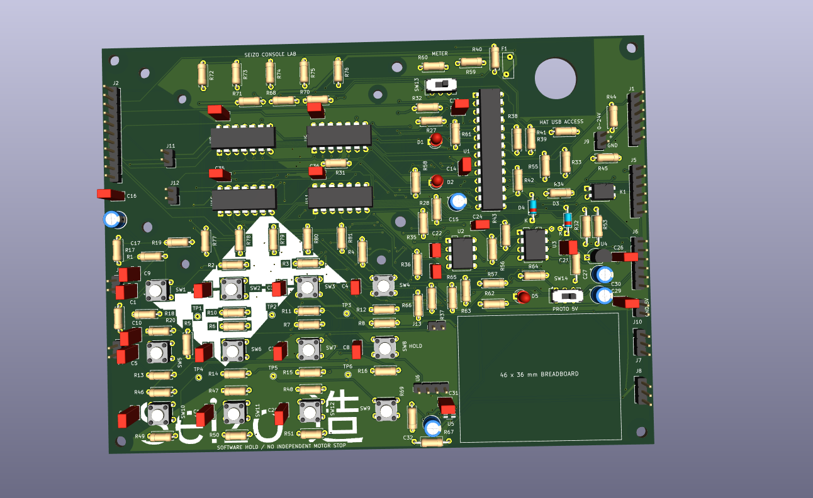
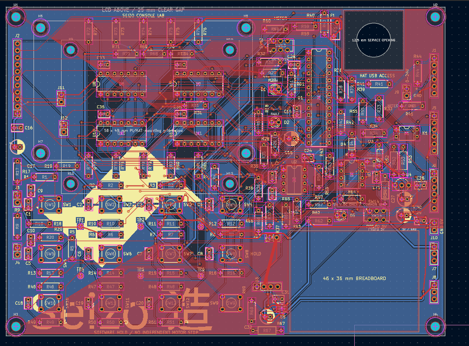

# Seizo Screen

Seizo Screen is a screen with a bunch of extra features that I find extremely useful for my robotic arm. There are lots of minor issues that are extremely annoying to work around, and this is my solution.

I want a screen so I can run direct motor controls without having to connect through my phone and worry about connections. I also wanted more features and wanted to make the whole thing look cooler.

## How I want to use it

During an arm session, I want to look at the screen and press a few buttons instead of doing everything on my phone. I want a "Run Arm" button that starts the arm setup. Keeping those controls on the arm would make it more independent. When this becomes a real product, I don't want using a phone to be required.

I want manual buttons for things like:

- Moving the base.
- Moving the wrist left and right.
- Opening and closing the gripper.
- Running the arm setup.

Eventually, I also want to let AI figure out the movements. The plan is to give it a prompt, have it convert that into individual movements, and then have the arm carry them out. This is something I'm planning to work on, and I think it would make everything much easier to use.

## The design challenge

One massive problem was organizing the components. I had to keep reorganizing them because none of the layouts seemed to be to my liking.

I originally had a much smaller PCB with fewer features. It felt like something that would take barely five minutes or so to put together, and it didn't seem cool enough to me. As a result, I changed it a lot by adding more features and making the PCB bigger.

I wanted things like a built-in meter and a breadboard area on the board. Making the PCB bigger gave me more room to do things like that. I'm planning to keep working on it and make it great.

## What I want to do next

Before the screen works with the arm, I need to do some basic sanity checks and make sure it works before connecting it to the arm. I might also try showing the Pi's output on it or adding some kind of built-in remote terminal, which would be extremely cool in my opinion.

I spent this summer designing and building the arm and worked on it almost every day. It has been extremely hard and difficult for me, and I want to make sure it works properly.

This has been my dream project for about a year, and I've struggled to find funding for all of it. I would really appreciate it if this project were accepted.

To be honest, soldering all the parts together by hand is extremely risky for me and it will take hours. I'd rather spend that time coding and making changes by hand and testing so I would like this to be presoldered please.

## Files

The Half-Life parts list had an 80-item (row) limit, so I used a grouped list for the submission. [Real_BOM.csv](Real_BOM.csv) contains the full ungrouped details, including each of the 150 fitted panel components, the screen, wiring and mounting items. It also identifies the matching HAT as a separate required dependency. [00-bom-halflife.csv](00-bom-halflife.csv) is the 27-row file for importing into Half-Life. Blank factory prices in the detailed BOM mean the quote is still pending, not that the parts are free.

- [Full detailed BOM](Real_BOM.csv)
- [KiCad project](szscreen.kicad_pro), [schematic](szscreen.kicad_sch) and [PCB](szscreen.kicad_pcb)
- [Schematic PDF](schematic.pdf)
- [Half-Life grouped BOM import](00-bom-halflife.csv) — 27 essential panel items within the 80-item limit; [import instructions](HALFLIFE-BOM-IMPORT.txt)
- [Earlier grouped project inventory](PROJECT-PARTS.csv) and [PCBWay preliminary price screenshot](quotes/pcbway/preliminary-calculator.png)
- [Parts list](BOM-panel.csv) and [connector pin map](CONNECTOR-PIN-MAP.csv)
- [Factory assembly BOM](assembly/BOM-PCBWay-panel.csv), [matching-HAT BOM](assembly/BOM-PCBWay-matching-HAT.csv), [DigiKey import CSV](assembly/DigiKey-panel-import.csv) and [assembly quote instructions](assembly/ORDER-INSTRUCTIONS.txt)
- [Factory quote upload ZIP](szscreen-PCBWay-turnkey-quote.zip)
- [Panel fabrication ZIP](szscreen-panel-Gerbers.zip)
- [Matching Pi HAT revision](matching-HAT/) and [assembly connections](ASSEMBLY-CONNECTIONS.txt)
- [Reference firmware](reference/firmware/) and [verification report](VERIFICATION.json)

## Contributions

The original schematic, PCB placement and full earlier routing were made by Vivaan, with his friend helping with ideas, parts, organization, routing and troubleshooting. ChatGPT/Codex helped with later schematic and PCB revisions, component and footprint selection, routing, checks and technical documentation. It generated the reference firmware from Vivaan's detailed behavior requirements. That code is reference only; Vivaan plans to write the actual implementation. The original earlier routing is preserved in [history/user-routed-rev19](history/user-routed-rev19/).

README narrative: my messages, with grammar and formatting fixed by AI.
